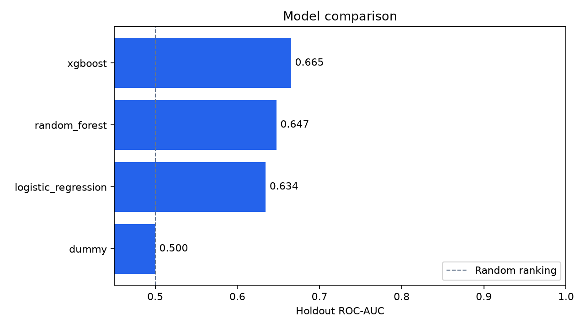
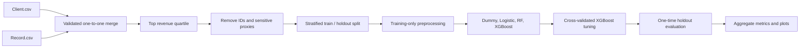
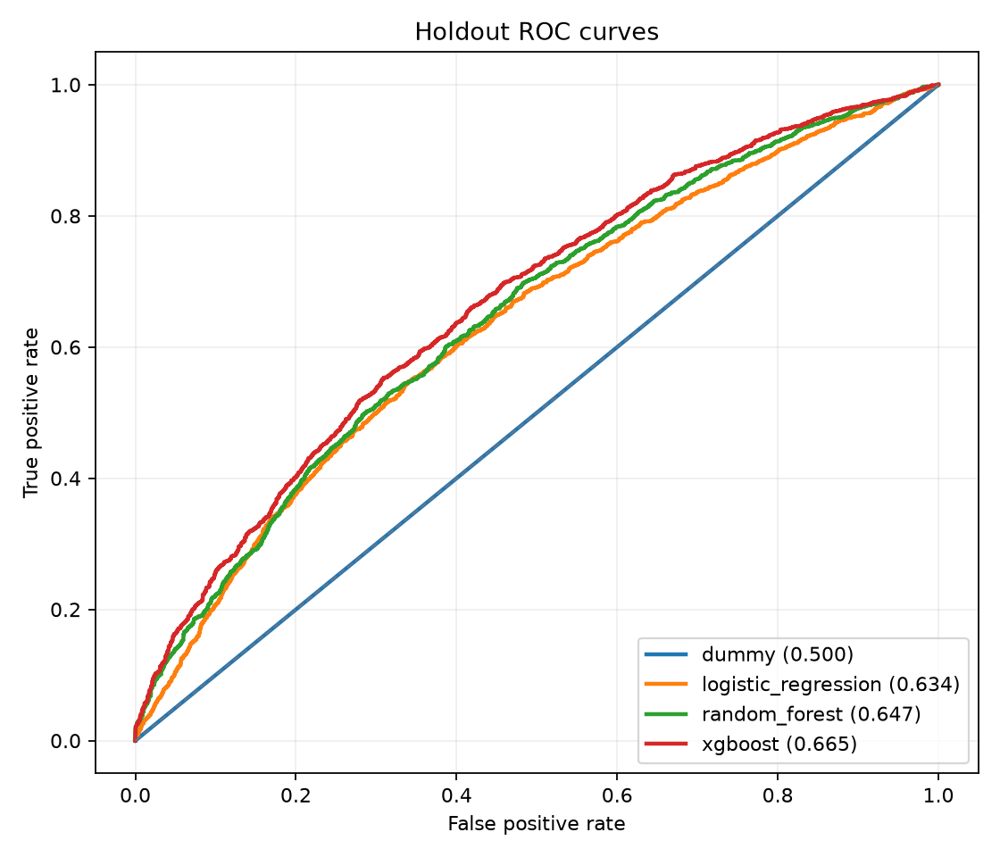
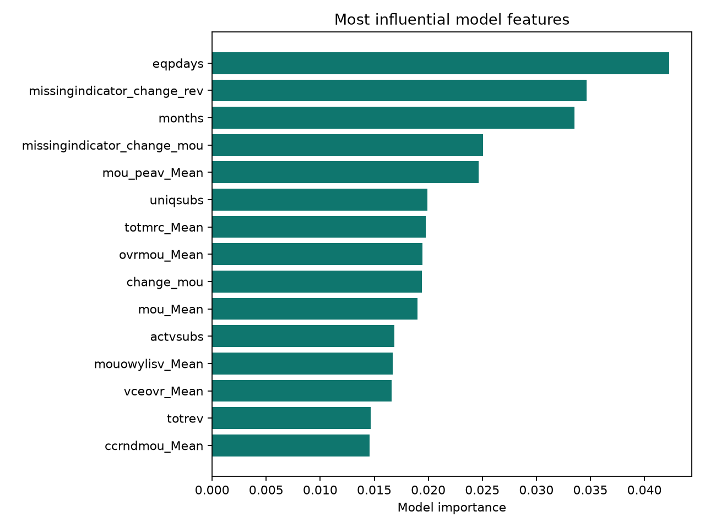

# Premium Customer Churn Prediction

An end-to-end machine-learning project for identifying churn risk among the
highest-revenue customers of an anonymous telecommunications provider.

The project began as the final assignment for **GCI World April 2026**, a data
science course organized by the Matsuo–Iwasawa Laboratory, Graduate School of
Engineering, The University of Tokyo. This repository is a portfolio-focused
rebuild of that work with leakage-safe preprocessing, an untouched holdout set,
reproducible training code, automated tests, privacy controls, and responsible-AI
documentation.

> The original course dataset is not redistributed because no public license was
> provided and the course materials reference strict data-protection constraints.

## Validated result

The latest local run used the original 100,000-row cohort and defined the premium
segment as customers at or above the 75th percentile of average revenue.

| Item | Result |
|---|---:|
| Premium-segment customers | 25,005 |
| Untouched holdout customers | 5,001 |
| Churn rate in segment | 48.57% |
| Model features after exclusions | 76 |
| Best model | Tuned XGBoost |
| Holdout ROC-AUC | **0.6652** |
| Holdout PR-AUC | **0.6479** |
| Holdout accuracy | **0.6191** |
| Holdout F1 | **0.5944** |



The result is moderate rather than production-ready. Its value is in demonstrating
a complete and auditable workflow, not in claiming that churn has been solved.

## Problem and approach

The business question is whether historical account and usage signals can rank
high-revenue customers by their near-term churn risk, allowing a retention team to
test targeted interventions.



The pipeline:

1. Validates that both source tables have unique, non-null customer identifiers.
2. Performs a one-to-one merge of customer and usage data.
3. Selects the top revenue quartile without using household composition.
4. Removes identifiers plus demographic, household, geographic, and credit proxies.
5. Creates a stratified 80/20 train/holdout split.
6. Fits imputation, scaling, and categorical encoding inside each training pipeline.
7. Compares a dummy baseline, logistic regression, random forest, and XGBoost.
8. Tunes XGBoost using five-fold cross-validation on training data only.
9. Evaluates the selected model once on the untouched holdout set.



## Interpretation

Equipment age, customer tenure, changes in recent usage, and several usage and
revenue aggregates contribute to the model. These are predictive associations,
not causal effects. A production team would need a randomized experiment to learn
whether a specific retention offer improves outcomes.



## Repository structure

```text
.
├── .github/workflows/tests.yml    # CI linting and tests
├── data/README.md                 # data policy and local placement
├── docs/
│   ├── model-card.md
│   └── responsible-ai.md
├── notebooks/churn_analysis.ipynb # guided analysis and validated outputs
├── reports/                       # privacy-safe aggregate results
├── scripts/
│   ├── build_notebook.py
│   └── generate_synthetic_data.py
├── src/churn_model/               # reusable training package and CLI
├── tests/                         # data and model smoke tests
├── pyproject.toml
└── requirements.txt
```

## Quick start with synthetic data

Python 3.11 or newer is recommended.

```bash
python -m venv .venv
```

Activate the environment:

```bash
# Windows PowerShell
.venv\Scripts\Activate.ps1

# macOS / Linux
source .venv/bin/activate
```

Install and run the privacy-safe smoke test:

```bash
pip install -e ".[dev]"
python scripts/generate_synthetic_data.py --output-dir data/synthetic
python -m churn_model.cli \
  --client data/synthetic/Client.csv \
  --record data/synthetic/Record.csv \
  --output-dir artifacts/synthetic \
  --quick
pytest
```

On PowerShell, the training command can be written on one line or use backticks
instead of backslashes for line continuation.

## Reproduce the validated private-data run

Authorized users can place the course files under `data/raw/` as described in
[the data policy](data/README.md), then run:

```bash
python -m churn_model.cli \
  --client data/raw/Client.csv \
  --record data/raw/Record.csv \
  --output-dir reports \
  --tune-xgboost
```

The command saves aggregate metrics and figures. The fitted model, raw inputs,
and row-level predictions are ignored by Git.

## Model comparison

| Model | ROC-AUC | PR-AUC | Accuracy | F1 |
|---|---:|---:|---:|---:|
| XGBoost | **0.6652** | **0.6479** | **0.6191** | **0.5944** |
| Random forest | 0.6474 | 0.6302 | 0.6049 | 0.5938 |
| Logistic regression | 0.6342 | 0.6048 | 0.6029 | 0.5774 |
| Dummy baseline | 0.5000 | 0.4857 | 0.5143 | 0.0000 |

Detailed machine-readable results are available in
[`reports/metrics.json`](reports/metrics.json).

## Responsible use

The source data contains attributes that could enable discriminatory targeting.
Twenty-two demographic, household, geographic, and credit-related variables are
excluded by default. This is a risk reduction measure, not proof of fairness.

Read the full [responsible-AI assessment](docs/responsible-ai.md) and
[model card](docs/model-card.md) before reusing the project.

## What changed from the course submission

- Corrected notebook execution order and removed dependence on Colab session state.
- Replaced full-dataset preprocessing with training-only pipelines.
- Defined premium customers consistently as the top revenue quartile.
- Preserved a final holdout set during hyperparameter selection.
- Corrected the distinction between ROC-AUC and accuracy.
- Removed unvalidated revenue-savings claims and arbitrary retention-score formulas.
- Excluded sensitive variables and private row-level outputs.
- Added reusable source code, automated tests, CI, synthetic data, and documentation.

## Author

**Nicolas Ernesto Juez Castañeda**  
[LinkedIn](https://www.linkedin.com/in/nicolas-juez-castaneda/) ·
[GitHub](https://github.com/NicoJC25) ·
[Portfolio](https://portafolio-web-nj.vercel.app/)

## License

Original code is available under the [MIT License](LICENSE). The dataset and
course materials are not included and are not covered by that license.
